<!-- ============ R.U.D.Y. HUD ============ -->

  

  

  
  

### 🧬 `IDENTITY // SYSTEM DIAGNOSTIC`

  

### ⚙️ `ARMORY // TECH STACK`

  

### 📡 `TELEMETRY // GITHUB STATS`

  
  

  

  

### 🛰️ `RADAR // CONTRIBUTION SCAN`

  

### 📶 `COMM LINK`

  

  

